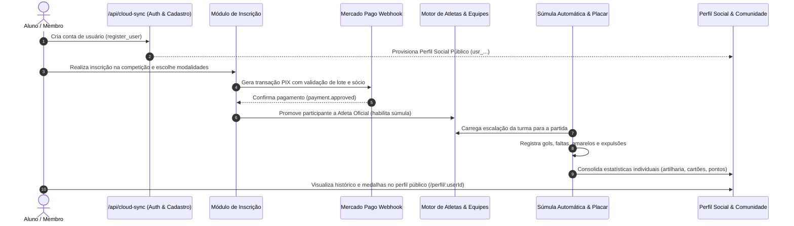

# ARQUITETURA DO SISTEMA — INTRAMED IX

**Plataforma Digital Esportiva Universitária**  
**Versão:** 2.0.0  
**Data:** 06/11/2026  
**Repositório:** `intramed-ix`

---

## 1. Visão Geral da Arquitetura

O **IntraMed IX** é estruturado como uma aplicação web progressiva (PWA) de alto desempenho, orientada a eventos e tolerante a falhas de rede, combinando um frontend moderno em **React 18** (Vite + TypeScript) a um backend serverless em **Node.js** integrado à nuvem corporativa do **Google Cloud Firestore**.

```mermaid
flowchart TD
    subgraph Client["Cliente Multi-Dispositivo (PC / Mobile / Tablet)"]
        UI["Interface de Usuário (React 18 + TailwindCSS)"]
        LocalCache["Engine de Cache Local (localStorage / indexedDB)"]
        SyncMgr["Sync Manager & Offline Mutation Queue"]
        UI <--> LocalCache
        UI <--> SyncMgr
    end

    subgraph API["Camada de API Serverless (/api)"]
        CloudSync["/api/cloud-sync (Endpoints REST)"]
        AuthHandler["Mecanismo de Autenticação (HMAC-SHA256 + Tokens)"]
        LGPDGuard["Filtro Sanitizador LGPD (sanitizeUserProfileForPublic)"]
        CloudSync --> AuthHandler
        CloudSync --> LGPDGuard
    end

    subgraph CloudDB["Google Cloud Firestore (Default DB)"]
        UsersCol["Coleção: users (Privada)"]
        ProfilesCol["Coleção: profiles (Pública)"]
        RegsCol["Coleção: registrations (Inscrições & Pagamentos)"]
        AthletesCol["Coleção: athletes (Atletas Oficiais)"]
        TeamsCol["Coleção: teams (Equipes e Turmas)"]
        MatchesCol["Coleção: matches (Calendário e Resultados)"]
        SheetsCol["Coleção: match_sheets (Súmulas Oficiais)"]
        AuditCol["Coleção: admin_audit_logs (Trilhas de Auditoria)"]
    end

    SyncMgr <-->|HTTPS REST / JSON| CloudSync
    CloudSync <-->|Firestore REST API / Service Account| UsersCol
    CloudSync <-->|Firestore REST API / Service Account| ProfilesCol
    CloudSync <-->|Firestore REST API / Service Account| RegsCol
    CloudSync <-->|Firestore REST API / Service Account| AthletesCol
    CloudSync <-->|Firestore REST API / Service Account| TeamsCol
    CloudSync <-->|Firestore REST API / Service Account| MatchesCol
    CloudSync <-->|Firestore REST API / Service Account| SheetsCol
    CloudSync <-->|Firestore REST API / Service Account| AuditCol
```

---

## 2. Modelo de Dados e Coleções

A plataforma adota um modelo estritamente desacoplado entre informações sensíveis de identidade e dados públicos esportivos/sociais:

| Coleção | Acesso | Conteúdo | Finalidade |
| :--- | :---: | :--- | :--- |
| **`users`** | **Privado** | `id`, `email`, `passwordHash`, `name`, `phone`, `document`, `role`, `createdAtIso`, `lastLoginAtIso`, `isActive` | Credenciais e auditoria de identidade civil e LGPD. |
| **`profiles`** | **Público** | `id`, `userId`, `displayName`, `avatarUrl`, `turma`, `turmaLabel`, `teamId`, `teamName`, `bio`, `instagramHandle`, `role`, `isAthlete`, `favoriteModalityIds`, `stats` | Diretório social da comunidade, páginas de perfil e torcida. |
| **`registrations`** | **Restrito** | `id`, `athleteName`, `email`, `cpf`, `phone`, `turma`, `teamId`, `status`, `paymentMethod`, `paymentId`, `amount`, `isMember` | Processamento financeiro (Mercado Pago), auditoria de sócio e emissão de ingresso. |
| **`athletes`** | **Público** | `id`, `name`, `turma`, `teamId`, `modalities`, `jerseyNumber`, `position`, `stats` | Elenco oficial de cada turma para escalação nas súmulas. |
| **`teams`** | **Público** | `id`, `name`, `turma`, `mascot`, `colors`, `shieldUrl`, `pointsTotal` | Agrupamento oficial das 5 turmas de Medicina UEMA. |
| **`matches`** | **Público** | `id`, `modalityId`, `homeTeamId`, `awayTeamId`, `date`, `time`, `location`, `status`, `scoreHome`, `scoreAway` | Tabela geral, calendário e match center ao vivo. |
| **`match_sheets`** | **Público** | `matchId`, `operatorName`, `events`, `lineupHome`, `lineupAway`, `signatures`, `finalized` | Súmula detalhada (gols, cestas, faltas, cartões amarelos, expulsões). |
| **`admin_audit_logs`**| **Restrito** | `id`, `action`, `performedByEmail`, `targetEmail`, `timestampIso`, `details` | Trilha de auditoria imutável de todas as ações de moderadores. |

---

## 3. Ciclo de Vida Integrado do Ecossistema Esportivo

O sistema conecta integralmente a jornada de cada membro através do seguinte fluxo:

---

## 4. Gerenciamento de Sessão e Persistência Multi-Dispositivo

1. **Tokens JWT com Criptografia HMAC-SHA256:**
   - Emissão de tokens de sessão no servidor com prazo de validade de 7 dias (`exp: iat + 86400 * 7`).
   - Assinatura gerada a partir da chave mestra do ambiente (`INTRAMED_AUTH_SECRET`), tornando impossível a falsificação pelo cliente.
2. **Hidratação Contínua de Estado:**
   - Ao abrir o app em qualquer dispositivo (PC, celular ou tablet), a aplicação faz uma chamada a `/api/cloud-sync` com `lastSyncTimestamp`.
   - Modificações realizadas em outro dispositivo são baixadas e integradas sem substituição destrutiva de dados locais.
3. **Controle de Sessão Offline:**
   - Tokens válidos e estado do usuário são persistidos em `localStorage` para navegação ininterrupta mesmo sem sinal de internet no ginásio esportivo.
