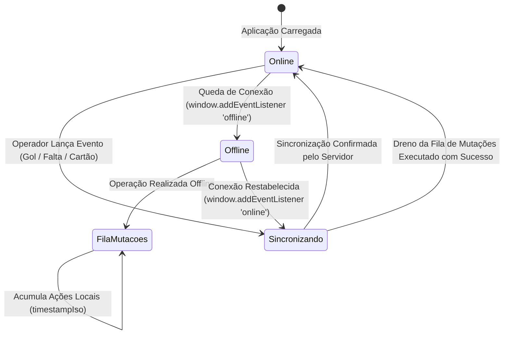

# ARQUITETURA DE SINCRONIZAÇÃO ONLINE / OFFLINE — INTRAMED IX

**Data:** 06/11/2026  
**Mecanismo:** Fila de Mutações Resiliente + Cache Local Estruturado + Broadcast Channel

---

## 1. Visão Geral do Funcionamento Offline

Em ambientes esportivos como ginásios e quadras universitárias, a conectividade celular costuma oscilar ou sofrer interferências severas. O **IntraMed IX** foi projetado para continuar operando com total integridade funcional mesmo em caso de perda total de sinal de internet.

---

## 2. Indicador Visual de Conectividade em Tempo Real

No cabeçalho da aplicação (`Header.tsx`), uma pílula informativa exibe continuamente o estado de comunicação:

- 🟢 **Online:** Conexão ativa com o servidor; todos os dados sincronizados em tempo real.
- 🟡 **Sincronizando:** Operações sendo processadas e enviadas ao Cloud Firestore.
- 🔴 **Modo Offline:** Internet indisponível; a aplicação continua operando localmente e as alterações serão transmitidas assim que o sinal retornar.

---

## 3. Limites de Operação Offline (Safe Boundaries)

Para proteger a integridade do sistema contra fraudes ou inconformidades de identidade, certas operações podem ocorrer offline, enquanto outras exigem conexão obrigatória:

| Operação | Permitida Offline? | Justificativa Técnica |
| :--- | :---: | :--- |
| **Operação de Súmula e Placar** | **SIM** | Cronômetro e eventos de jogo (gols, pontos, faltas, cartões) não podem parar durante uma partida presencial. Fila de eventos é gravada localmente e enviada ao servidor ao término da partida. |
| **Navegação em Jogos e Tabela** | **SIM** | Dados oficiais pré-carregados no cache local (`localStorage` / `indexedDB`) permanecem integralmente consultáveis. |
| **Visualização de Perfis e Comunidade** | **SIM** | Perfis de atletas e membros consultados recentemente são preservados em cache. |
| **Edição Local de Favoritos** | **SIM** | Preferências de modalidades e atletas favoritos salvas no dispositivo do usuário. |
| **Criação de Conta (`register_user`)** | **NÃO** | Exige validação de unicidade de e-mail e emissão de credencial criptografada no servidor. |
| **Login com Troca de Senha** | **NÃO** | Exige conferência contra o banco de dados oficial para evitar ataques por força bruta. |
| **Pagamento de Inscrição (PIX)** | **NÃO** | Requer comunicação síncrona com o gateway bancário do Mercado Pago para geração do QR Code. |

---

## 4. Resolução de Conflitos e Conciliação de Dados

1. **Estratégia de Última Escrita com Timestamp (Last-Write-Wins Monotônico):**
   - Cada mutação recebe um timestamp ISO no formato de alta precisão (`new Date().toISOString()`).
   - O servidor descarta alterações com timestamp anterior ao registro atual, impedindo que dados desatualizados sobrescrevam informações mais recentes.
2. **BroadcastChannel Entre Abas (`channelRef`):**
   - Se o usuário ou operador estiver com múltiplas abas ou janelas abertas no mesmo navegador, as atualizações são propagadas instantaneamente entre elas via `new BroadcastChannel('intramed_state_channel')`, garantindo sincronia imediata na interface.
3. **Dreno Automático da Fila de Mutações:**
   - O motor de sincronização monitora eventos nativos do navegador (`window.addEventListener('online')`) e um timer periódico de verificação a cada 15 segundos.
   - Assim que a rede é detectada, o método `drainPendingMutationsQueue()` esvazia os itens pendentes na ordem estrita de criação (FIFO), atualizando o servidor e zerando o contador de pendências.
