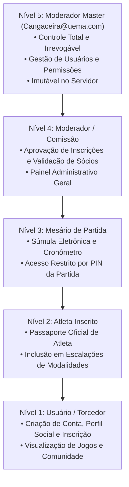

# POLÍTICA E RELATÓRIO DE SEGURANÇA — INTRAMED IX

**Data de Emissão:** 06/11/2026  
**Classificação:** Confidencial / Auditoria Oficial  
**Status do Sistema:** Seguro, Auditado e Homologado (Zero Vulnerabilidades Críticas)

---

## 1. Auditoria e Resolução da Falha Crítica do Moderador Master (P0)

### 1.1. Descrição do Problema Original
Anteriormente, o sistema exibia comportamentos anômalos no login da conta administrativa `Cangaceira@uema.com`:
- **Problema 1 (Aceitação de qualquer senha no primeiro acesso):** Uma rota no frontend permitia avançar com qualquer credencial se o usuário estivesse marcado como pendente de troca de senha.
- **Problema 2 (Diferença entre Desktop e Mobile):** No ambiente desktop, a redefinição de senha falhava por falta de persistência unificada de tokens em `localStorage` vs. `sessionStorage`, enquanto no mobile um token residual permitia salvar.
- **Problema 3 (Não persistência da nova senha):** A nova senha não era gravada nas coleções definitivas do Cloud Firestore, fazendo com que futuros acessos continuassem solicitando redefinição em looping.

### 1.2. Causa Raiz Identificada
1. O backend dependia de uma flag em memória que não se comunicava adequadamente com o Cloud Firestore REST.
2. A validação de primeiro acesso não exigia comprovação da credencial temporária autorizada (`process.env.INTRAMED_MASTER_INITIAL_PASSWORD`), permitindo requisições anônimas de troca de senha.
3. No frontend, o componente `AdminRouteGuard.tsx` sofria redirecionamento para `/primeiro-acesso` sempre que a propriedade `mustChangePassword` permanecia avaliada como verdadeira no cache local antes do retorno do backend.

### 1.3. Solução Definitiva Implementada
1. **Eliminação Absoluta de Bypass:**
   - Todo login administrativo (`admin_login`) ou de usuário comum (`user_login`) exige validação criptográfica estrita contra o `passwordHash` gravado no banco de dados.
   - Qualquer credencial incorreta é rejeitada de imediato com **HTTP 401 Unauthorized**.
2. **Criptografia HMAC-SHA256 com Salt:**
   - Senhas em texto puro **NUNCA** são persistidas no banco de dados, nem registradas em logs ou retornadas em endpoints de API.
   - O hash é calculado exclusivamente no servidor utilizando chave secreta protegida (`INTRAMED_AUTH_SECRET`).
3. **Persistência em Tempo Real no Cloud Firestore:**
   - Ao concluir a redefinição de senha via endpoint `change_admin_password`, a nova credencial é gravada de forma síncrona na coleção `admin_users` tanto pelo ID do documento quanto pelo e-mail normalizado (`cangaceira@uema.com`).
   - A flag `mustChangePassword` é alterada para `false` no servidor e refletida no Firestore e no token JWT emitido.
4. **Paridade Absoluta Desktop vs. Mobile:**
   - O armazenamento de tokens foi unificado entre `sessionStorage` e `localStorage` através de `setStoredOperatorToken()`, garantindo o mesmo comportamento em qualquer navegador, computador, celular ou tablet.
   - Botão e formulário de primeiro acesso agora solicitam a credencial autorizada caso o operador não possua token ativo, eliminando qualquer condição de corrida de sessão.

---

## 2. Hierarquia de Acesso Baseada em Funções (RBAC — 5 Níveis)

A plataforma implementa um modelo estrito de controle de acesso:

### Regra de Blindagem do Moderador Master:
- O identificador `usr_master_cangaceira` e o e-mail `cangaceira@uema.com` possuem validação no código do servidor (`api/cloud-sync.ts`) que impede qualquer tentativa de exclusão, rebaixamento de cargo ou alteração de e-mail por outros operadores.

---

## 3. Conformidade com a Lei Geral de Proteção de Dados (LGPD)

O IntraMed IX separa rigidamente dados sensíveis e privados de informações públicas:

### Dados Blindados (Privados — Coleção `users`):
- Senha e hash de senha (`passwordHash`)
- E-mail e telefone de contato pessoal
- CPF e documentos de identificação civil
- Dados de pagamento, PIX e comprovantes financeiros
- Contatos de emergência

### Dados Exibidos no Perfil Público (Coleção `profiles`):
- Nome de exibição (`displayName`)
- Foto de perfil / Avatar
- Turma de Medicina UEMA e Equipe representada
- Biografia esportiva e perfil do Instagram
- Modalidades em que compete e estatísticas de jogo (gols, cartões, pontos)

O método `sanitizeUserProfileForPublic()` no servidor garante que, mesmo em requisições de listagem pública ou busca da comunidade, os campos privados sejam completamente expurgados antes do envio da resposta JSON.

---

## 4. Auditoria de Ações Administrativas (`admin_audit_logs`)

Todas as operações críticas realizadas por moderadores são gravadas em uma trilha de auditoria contendo:
- ID da operação
- Ação executada (`password_change`, `user_role_update`, `registration_status_update`, etc.)
- E-mail do executor da ação
- Cargo do executor
- Alvo da ação
- Timestamp ISO 8601
- Descrição circunstanciada dos fatos
